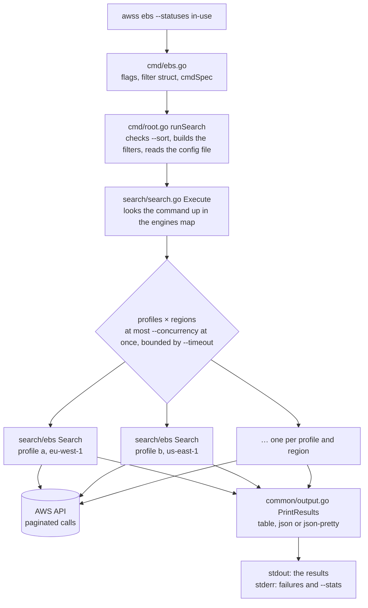

# Architecture

This is the map of awss: how a command travels from the terminal to AWS and back, and which
package does what. Read it before changing the structure. When a change moves, adds or removes a
piece of this map, update this file in the same pull request, and say so in the pull request's
"Where this sits on the map" section.

A test (`internal/doclist`) fails when a package is missing from the [Packages](#packages) table.

## How a command runs

Take `awss ebs --statuses in-use --profiles a,b --regions all`:

1. **Command** (`cmd/<resource>.go`). Cobra parses the flags into a filter struct whose
   `filter:"..."` tags are the AWS filter names. The `RunE` calls `runSearch` with a `cmdSpec`
   that names the command's viper keys and its optional flags.
2. **Run** (`cmd/root.go`, `runSearch`). Checks the sort field, turns the filter struct into a
   `map[string][]string`, looks up account names when the engine shows an Owner column, and
   calls `search.Execute` with the profiles, the regions and a `search.Options`.
3. **Fan-out** (`search/search.go`, `Execute`). Finds the engine of the command in the `engines`
   map and runs one search per profile and region on a pool of workers. A search still running
   at the `--timeout` deadline is replaced by an empty result set holding a timed-out error; the
   others are kept.
4. **Search** (`search/<resource>/`). The engine's `New` builds a result set for one profile and
   region; `Search(ctx)` calls AWS, turns each response into rows and sorts them. An error is
   recorded in the result set and never stops the run.
5. **Output** (`common/output.go`). Each finished result set is printed as it arrives. The
   columns, their headers, stacked and hidden columns all come from struct tags on the row type,
   so the output layer never knows which resource it prints.

## The pieces

**`common.Results`** is the contract every engine implements: the profile, region and errors
of its result set (from the embedded `common.BaseResults`), its rows and headers, and
`Search(ctx)`. The runner and the output only ever see this interface.

**The engines map** (`search/search.go`) is the registry: one entry per command, keyed by the
command name, or by its `awss-engine` annotation for a command inside a group (`cloudwan routes`
is `cloudwan-routes`). An entry holds the constructor, the sort field functions and whether the
engine shows account names. Tests check that the commands and the engines match both ways.

**Row structs and tags.** A row type's fields carry `json`, `header` and `sort` tags; `stack`
puts a field in the column before it, on a new line, and `hide:"empty"` hides a column that is
empty in every row. `common.Headers`, `common.Rows`, `common.SortFields` and
`common.SortByField` (`common/rows.go`) read these tags, so a new column is one field.

**Filters** travel as `map[string][]string`, keyed by the AWS filter name. Each engine turns
them into its AWS input in `getFilters`; engines with client-side filters (names, versions,
tags, CloudFront, Cloud WAN) match the rows after the AWS call. The map is shared by every
search of a run, so an engine copies it before changing it.

**Global services.** Organizations, CloudFront, Network Manager (Cloud WAN) and Direct Connect
gateways are global. Their commands set one region, the engine's `Region`, so the fan-out runs
once per profile.

**Why the cleanup commands use the search runner.** `cleanup default-vpc` and
`cleanup dhcp-options` are registered in the same engines map as the searches, so `search`
imports `cleanup`. This is deliberate: it gives the cleanups the same parallel runner, timeout,
summary and output for free. Deleting stays guarded: a cleanup only reports its plan unless
`--apply` is given, `--apply` over `--profiles all` or `--regions all` also needs `--confirm-all`,
and neither flag is bound to the config file. Do not move them out without a reason that
outweighs this.

## Packages

| Package | What it does |
|---|---|
| `cmd/` | Cobra commands and flags, viper binding, `runSearch`, completion, `--stats` |
| `common/` | The `Results` contract, `BaseResults`, AWS config helpers, filter builders, output, row and sort helpers, matchers |
| `search/` | The engines map, `Options` and the profiles × regions fan-out |
| `search/ec2/` | EC2 instances; also `InstanceNames`, used by ebs and eni |
| `search/eni/` | Network interfaces |
| `search/ebs/` | EBS volumes, one row per attachment |
| `search/vpc/` | VPCs |
| `search/subnet/` | Subnets, and the subnets that overlap given CIDRs (used by `ec2 --cidrs`) |
| `search/s3/` | S3 buckets, matched by name client-side |
| `search/s3obj/` | S3 object keys inside given buckets, capped by `--max-keys` and `--max-buckets` |
| `search/rds/` | RDS DB instances |
| `search/rdscluster/` | RDS DB clusters, reusing the rds client-side filters |
| `search/org/` | AWS Organization accounts, and the account names for `--org-profile` |
| `search/cloudfront/` | CloudFront distributions (global) |
| `search/cloudwan/` | Cloud WAN routes and BGP routes (global), and the Network Manager client the Cloud WAN searches share |
| `search/cloudwanatt/` | Cloud WAN attachments (global) |
| `search/dxgw/` | Direct Connect gateways with their associations, allowed prefixes and VIFs (global) |
| `search/tgw/` | Transit Gateway routes, attachments and their propagations (regional) |
| `cleanup/` | What the cleanups share: statuses, the caller account, AWS error helpers |
| `cleanup/defaultvpc/` | Deletes the default VPC and its plumbing, all or nothing |
| `cleanup/dhcpoptions/` | Deletes the DHCP options sets no VPC uses |
| `internal/testconv/` | Checks the test naming and structure convention |
| `internal/nesting/` | Checks the nesting depth of every function |
| `internal/doclist/` | Checks this table and the package layout of `AGENTS.md` list every package |

`main.go` only calls `cmd.Execute()`.

## Adding an engine

The steps are in `AGENTS.md`, "Adding new resource types". The engine touches every row of the
flow above except the fan-out and the output, which stay generic.
